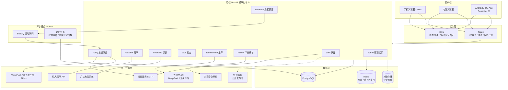
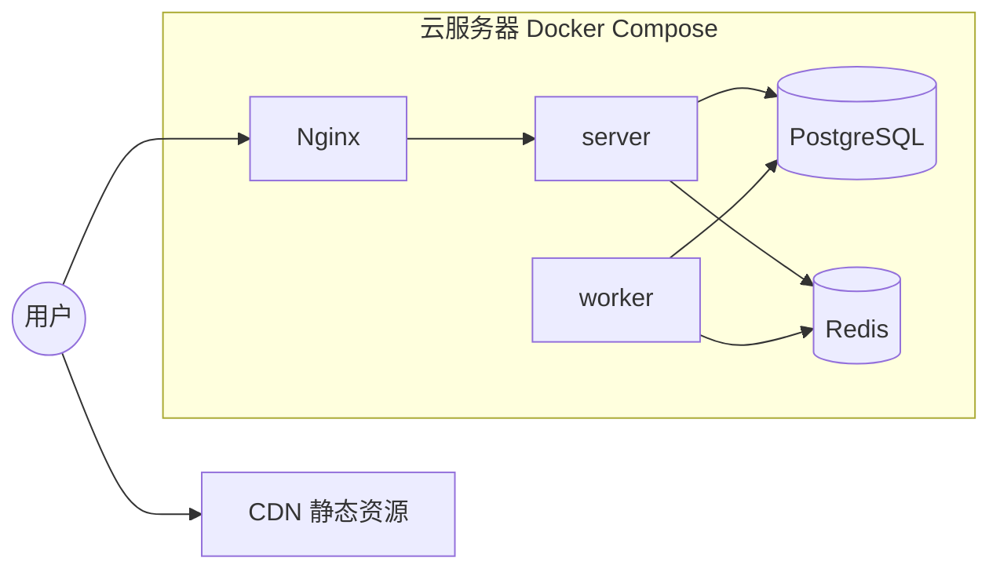

# 02 总体架构与技术选型

## 1. 架构总览

采用「一套 Web 前端 + 模块化单体后端」。前端先以 PWA 形式同时服务手机和电脑，再用 Capacitor 打包成 App，复用同一份代码。后端先做模块化单体，模块间边界清晰，流量上来后可把提醒、推荐等模块拆为独立服务。



## 2. 技术选型

### 2.1 前端

| 类别 | 选型 | 理由 |
| --- | --- | --- |
| 框架 | React 19 + TypeScript 6 + Vite 8 | 3D 生态（React Three Fiber）最成熟；Vite 构建快 |
| 路由 | React Router 8（Data 模式，`createBrowserRouter`） | |
| 样式 | Tailwind CSS + CSS 变量主题 | 便于按天气动态切换主题色 |
| 动效 | Motion（原 Framer Motion，`motion/react`）+ GSAP（复杂时间线，按需引入） | layout / shared element 动画适合卡片展开 |
| 3D | three.js + @react-three/fiber + @react-three/drei | 声明式 3D，组件化管理场景 |
| 3D 资源 | glTF/GLB + Draco/Meshopt 压缩，KTX2 纹理 | 体积小、加载快 |
| 服务端状态 | TanStack Query | 缓存、重试、离线持久化 |
| 客户端状态 | Zustand | 轻量 |
| 表单校验 | React Hook Form + Zod（与后端共享 schema） | |
| PWA | vite-plugin-pwa（Workbox） | 离线缓存、Web Push |
| App 打包 | Capacitor（做 App 时用当时的最新版） | 直接复用 Web 代码与 WebGL；有本地通知、推送、定位等原生插件 |
| 设备分级 | detect-gpu | 按 GPU 能力决定 3D/玻璃效果档位 |

**为什么 App 选 Capacitor，不选 Flutter / React Native：** 本项目视觉依赖 WebGL 3D 和 CSS `backdrop-filter`。Flutter 和 React Native 需要另写一套 UI，3D 支持也弱于 three.js。Capacitor 用系统 WebView 承载现有 Web 应用，一套代码三端运行。代价是极端复杂的交互性能略逊于原生，对本项目的页面复杂度可以接受。如果以后需要桌面小组件、灵动岛等原生能力，可以在 Capacitor 中写原生插件补充。

### 2.2 后端

| 类别 | 选型 | 理由 |
| --- | --- | --- |
| 运行时与框架 | Node.js 24 + NestJS 12（ESM） | 与前端同为 TypeScript，可共享类型；模块化结构清晰 |
| ORM | Prisma 7（`@prisma/adapter-pg` 驱动适配器） | 类型安全、迁移管理方便。注意 npm 上 `prisma@latest` 当前指向 8 的预发布版，需固定在 7 |
| 数据库 | PostgreSQL 16 | 关系数据为主；JSONB 存偏好等半结构化数据 |
| 缓存/队列 | Redis 7 + BullMQ（S2 引入） | 天气缓存、榜单 Sorted Set、提醒延时队列 |
| 认证 | JWT access token（15 分钟，只存前端内存）+ 刷新令牌（30 天，HttpOnly Cookie，数据库只存 SHA-256 摘要，每次刷新轮换，旧令牌重放时吊销该用户全部会话） | 自己实现，没用 `@nestjs/authentication`：它面向密码 / 魔法链接登录，而本项目用邮箱验证码 |
| 校验 | Zod 4 schema 放在 `packages/shared`，后端用 Nest 自带的 `StandardSchemaValidationPipe`，前端表单复用同一份 | |
| 代码检查 / 测试 | oxlint + Vitest（Nest 12 新项目默认） | |
| 文件存储 | 阿里云 OSS / 腾讯云 COS，前端直传（STS 临时凭证） | |
| API 文档 | OpenAPI（@nestjs/swagger），前端用 openapi-typescript 生成类型 | |
| 日志与监控 | Pino 日志 + Sentry（前后端错误）+ Prometheus/Grafana（可选） | |

### 2.3 第三方服务

| 用途 | 推荐 | 备选 |
| --- | --- | --- |
| 天气 | 和风天气（QWeather），免费额度够 MVP | 心知天气、彩云天气（分钟级降水更准） |
| 大模型 | DeepSeek API（价格低） | 通义千问、豆包 |
| Web 推送 | 标准 Web Push（VAPID） | |
| App 推送 | 极光推送 / 个推（国内安卓需厂商通道），iOS 走 APNs | FCM（国内不可用，仅海外） |
| 邮件（登录验证码、提醒） | 自用阶段：QQ / 163 邮箱 SMTP（授权码，免费） | 公开后：阿里云邮件推送、Resend |
| 短信（公开发布时绑定手机号） | 阿里云短信 | 腾讯云短信 |
| 内容审核 | 阿里云内容安全 / 腾讯云天御 | 本地敏感词库兜底 |

## 3. 代码仓库结构

使用 pnpm workspace 管理的 monorepo（一个人开发，不引入 Turborepo，构建脚本用 pnpm 的 `-r` / `--filter` 即可）。

```
gduthelp/
├── apps/
│   ├── web/                 # React Web 应用（同时是 Capacitor 的 Web 资源）
│   │   ├── src/
│   │   │   ├── app/         # 路由、布局、全局 Provider
│   │   │   ├── features/    # 按功能划分：weather / timetable / food / todo / ranking / me / admin
│   │   │   ├── components/  # 通用组件（GlassCard、TabBar 等）
│   │   │   ├── three/       # 3D 场景、模型组件、着色器
│   │   │   ├── motion/      # 动效预设（spring 参数、过渡）
│   │   │   ├── lib/         # api client、存储、设备分级
│   │   │   └── styles/
│   │   └── public/models/   # 压缩后的 GLB
│   ├── mobile/              # Capacitor 工程（android/、ios/），引用 web 的构建产物
│   └── server/              # NestJS 后端
│       └── src/modules/     # auth / user / weather / timetable / todo / reminder / recommend / review / notify / admin
├── packages/
│   └── shared/              # Zod schema、类型、常量、广工校区与作息配置（前后端共用）
├── docs/
├── docker/                  # Dockerfile、docker-compose
└── .github/workflows/       # CI
```

## 4. 部署架构

### 4.1 自用阶段（当前）

第一版只给开发者本人使用，没有服务器和域名，也不需要 ICP 备案（不对公网开放的服务不涉及备案）。

| 步骤 | 做法 | 说明 |
| --- | --- | --- |
| 开发期 | 在自己电脑上 `docker compose up` 跑全部服务；手机和电脑都装 Tailscale，用 `tailscale serve` 把本机服务以 `https://<机器名>.<tailnet>.ts.net` 暴露到自己的设备 | Tailscale 自动签发有效 HTTPS 证书，PWA 安装和 Web Push 都要求 HTTPS；免费 |
| 日常使用期 | 提醒依赖服务一直在线，电脑休眠就会漏提醒。等开始每天依赖提醒时，租一台低配云服务器（1 核 2G 即可），同样只通过 Tailscale 访问，不开放公网 80/443 端口 | 不对公网提供服务，不需要备案和域名 |
| 备份 | 每日 `pg_dump` 到本机或网盘 | |

自用阶段不使用 CDN，前端静态文件由 Nginx 直接提供。

### 4.2 公开发布时

需要：域名 + 国内服务器 + ICP 备案（个人主体，约 2–3 周），或者使用香港/海外服务器免备案（国内访问速度较差）。同时接入短信绑定手机号、内容审核、CDN。一台 2 核 4G 云服务器即可：



- 前端构建产物上传 CDN，Nginx 只代理 `/api`（公开发布后）。
- `server` 与 `worker` 是同一份代码的两个启动入口：`server` 处理 HTTP，`worker` 消费队列、跑定时任务。这样提醒调度不受 API 发布重启影响。
- 数据库每日自动备份到对象存储，保留 7 天。
- 只服务广工学生，用户规模有上限（万级），单机足够，不规划水平扩展。

## 5. 环境与 CI/CD

| 环境 | 用途 |
| --- | --- |
| local | Docker Compose 起 PostgreSQL + Mailpit；没有 Docker 时用 `prisma dev` 起本地 Postgres（见 docs/DEVELOPMENT.md） |
| production | 推送 `main` 分支自动部署（有云服务器之后；之前直接在本机运行） |

不单独设测试环境，一个人维护两套环境成本高。改用：本地 Docker Compose 与生产配置一致；新功能用功能开关（环境变量）控制，上线后先只对自己的账号开启。

CI 流程（GitHub Actions）：lint → 类型检查 → 单元测试 → 构建 → Lighthouse 性能检查（首页性能分低于 85 报警）→ 构建镜像 → SSH 到服务器 `docker compose pull && up -d`。

密钥（天气 Key、大模型 Key、数据库密码、VAPID 私钥）只放在环境变量或云密钥管理服务，不进仓库。

## 6. 单人开发的取舍

| 方面 | 做法 | 原因 |
| --- | --- | --- |
| 管理后台 | 不单独建后台应用，做成 Web 应用里的 `/admin` 页面，仅管理员角色可见 | 少维护一个项目，复用玻璃组件即可 |
| 后端形态 | 模块化单体，`server` 和 `worker` 同一份代码 | 一次构建、一个镜像 |
| 内容审核 | 优先接第三方自动审核，人工只处理疑似内容 | 一个人看不过来所有评论 |
| 商家上架 | 管理员审核或多人确认自动上架（见后端文档） | 不让审核成为瓶颈 |
| 监控 | 只接 Sentry（免费额度）+ 服务器自带监控告警，不搭 Prometheus | 够用且零运维 |
| 测试 | 重点测提醒调度、推荐打分、贝叶斯排名这类纯逻辑；界面以手动真机验证为主 | 把测试时间花在最容易出错、最难手测的地方 |
