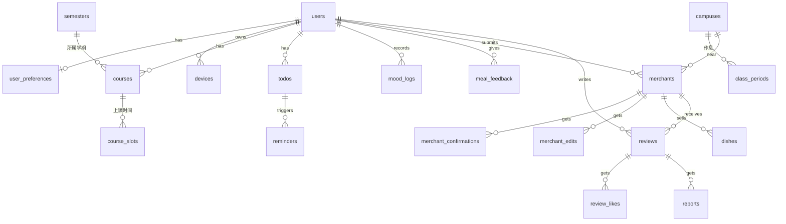
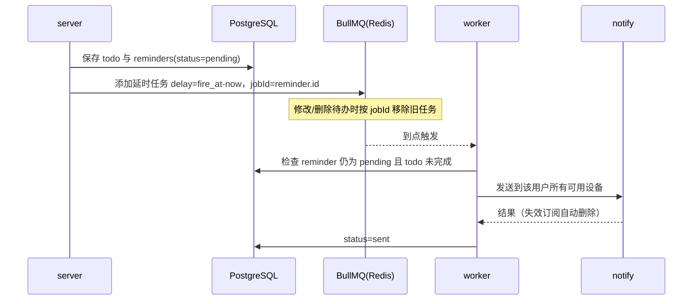
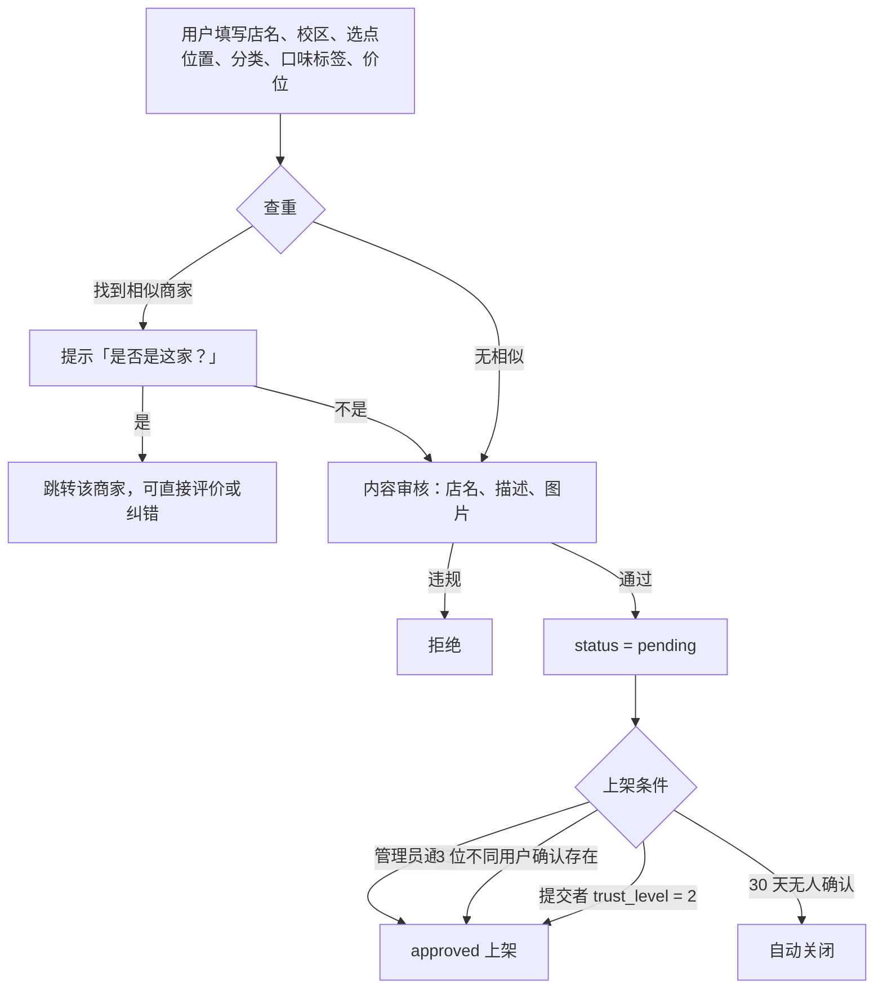

# 03 后端设计

## 1. 模块划分

| 模块 | 职责 | 依赖 |
| --- | --- | --- |
| auth | 邮箱验证码登录、JWT 签发与刷新；公开发布时增加手机号绑定 | user、邮件服务（SMS 后期） |
| user | 用户资料、偏好（口味、忌口、预算）、所在校区、角色（user/admin） | |
| weather | 天气查询与缓存 | 和风天气、Redis |
| timetable | 学期、作息、课程、导入 | 教务系统（可选） |
| todo | 待办 CRUD、重复规则 | reminder |
| reminder | 提醒计算与调度 | timetable、BullMQ、notify |
| recommend | 心情记录、餐食推荐、反馈 | weather、timetable、review、LLM |
| merchant | 用户提交商家与菜品、查重、确认上架、纠错 | 内容审核 |
| review | 评分、评论、榜单、举报 | merchant、OSS、内容审核、Redis |
| notify | 统一推送出口（Web Push / 邮件 / 站内信 / App 推送） | 推送服务、邮件服务 |
| admin | 管理接口：商家/纠错审核、评论审核、封禁、维护学期日期 | 以上全部 |

模块之间只通过各自导出的 Service 调用，不直接访问对方的数据表。以后拆服务时，把 Service 调用换成 HTTP/消息即可。

## 2. 数据模型



主要表字段（省略 `id`、`created_at`、`updated_at`）：

| 表 | 关键字段 |
| --- | --- |
| users | email(唯一，登录凭据), phone(唯一，可空，公开发布后用于实名), nickname, avatar, campus_id, role(user/admin), trust_level(0–2), status(normal/banned) |
| user_preferences | tastes(JSONB: 辣/甜/清淡…), dislikes(JSONB), budget_min, budget_max, remind_settings(JSONB) |
| devices | user_id, platform(web/android/ios), push_token / web_push_subscription(JSONB), last_active_at |
| campuses | name, city_code(和风城市 ID), lat, lng（广工各校区，作为种子数据内置，不提供增删接口） |
| class_periods | campus_id, period_no, start_time, end_time |
| semesters | name, start_date, total_weeks, is_current（全校统一，管理员每学期维护一次，用户不用自己填开学日期） |
| courses | user_id, semester_id, name, teacher, color, source(manual/import/share/jw) |
| course_slots | course_id, weekday(1–7), period_start, period_end, weeks(int[]), location |
| todos | user_id, title, note, due_at, priority(1–4), tags(text[]), repeat_rule(RRULE 字符串), status, completed_at |
| reminders | todo_id / course_slot_id, user_id, fire_at, kind(manual/smart/course), status(pending/sent/cancelled), job_id |
| mood_logs | user_id, date, mood(enum), note |
| merchants | name, category, campus_id, location_text, lat, lng, price_level, tags(text[]: 辣/清淡/汤/面/饭/甜品/热食/凉食…), open_hours(JSONB), submitted_by, confirm_count, status(pending/approved/rejected/closed), rating_avg, rating_count, bayes_score |
| merchant_confirmations | merchant_id, user_id（联合唯一）, kind(exists/closed) |
| merchant_edits | merchant_id, user_id, changes(JSONB), confirm_count, status(pending/applied/rejected) |
| dishes | merchant_id, name, price, tags(辣/汤/面/饭…), submitted_by, status(visible/hidden)（可选数据，推荐不依赖它） |
| reviews | user_id, merchant_id, score_taste, score_value, score_env, score_speed, score_overall, content, images(text[]), like_count, status(visible/hidden/pending) |
| review_likes | review_id, user_id（联合唯一） |
| reports | review_id, reporter_id, reason, status |
| meal_feedback | user_id, dish_id/merchant_id, meal(lunch/dinner), action(accepted/skipped/disliked), date |

约束：`reviews(user_id, merchant_id)` 联合唯一，每人每商家一条主评价，修改即覆盖并重算分数。

## 3. API 设计

RESTful，前缀 `/api/v1`，统一返回 `{ code, data, message }`。列表接口用游标分页 `?cursor=&limit=`。

| 模块 | 方法与路径 | 说明 |
| --- | --- | --- |
| auth | `POST /auth/email-code` | 发 6 位邮箱验证码，10 分钟有效（同邮箱 60s 一次，每日 10 次；同 IP 每日 30 次） |
| | `POST /auth/login` | 邮箱 + 验证码登录（首次即注册），返回 access + refresh |
| | `POST /me/phone` | 绑定手机号（公开发布时启用） |
| | `POST /auth/refresh` | 刷新令牌 |
| user | `GET/PATCH /me`、`GET/PUT /me/preferences` | |
| | `POST /me/devices` | 注册推送设备/订阅 |
| weather | `GET /weather/today?lat=&lng=` 或 `?campusId=` | 实时 + 逐小时 + 预警 |
| timetable | `GET /timetable/today`、`GET /timetable/week?week=` | |
| | `CRUD /semesters`、`CRUD /courses` | |
| | `POST /timetable/import/file`、`POST /timetable/import/jw` | 导入 |
| todo | `CRUD /todos`、`POST /todos/:id/complete` | |
| | `GET /todos/:id/reminders`、`PUT /todos/:id/reminders` | |
| recommend | `PUT /mood/today` | 记录心情 |
| | `GET /recommend/meals?meal=lunch` | 返回候选与理由 |
| | `POST /recommend/feedback` | 接受 / 换一个 / 不喜欢 |
| merchant | `GET /merchants?category=&campusId=`、`GET /merchants/:id` | 只返回已上架商家 |
| | `GET /merchants/similar?name=&lat=&lng=` | 提交前查重 |
| | `POST /merchants` | 提交新商家 |
| | `GET /merchants/pending?campusId=` | 本校区待确认的商家 |
| | `POST /merchants/:id/confirm` | 确认「存在」或「已关店」 |
| | `POST /merchants/:id/edits`、`POST /merchant-edits/:id/confirm` | 纠错与确认纠错 |
| | `POST /merchants/:id/dishes` | 补充菜品 |
| review | `GET /rankings?type=overall/category/weekly` | |
| | `PUT /merchants/:id/review`、`DELETE /merchants/:id/review` | 写/改/删自己的评价 |
| | `GET /merchants/:id/reviews`、`POST /reviews/:id/like`、`POST /reviews/:id/report` | |
| | `POST /uploads/sts` | 获取图片直传凭证 |
| notify | `GET /notifications`、`POST /notifications/read` | 站内信 |
| admin | `GET /admin/queue?type=merchant/edit/review/report` | 待处理队列 |
| | `POST /admin/{type}/:id/approve`、`POST /admin/{type}/:id/reject` | |
| | `PUT /admin/semesters/current`、`POST /admin/users/:id/ban` | |

## 4. 各功能实现方案

### 4.1 天气

1. 前端拿到经纬度后请求后端，后端把经纬度换成和风城市 ID（结果缓存 7 天）。用户已绑定广工校区时，默认直接用校区的 `city_code`，不需要定位权限；只有用户在校外时才需要定位。
2. 天气数据按城市 ID 缓存在 Redis：实时天气 10 分钟、逐小时 30 分钟、预警 10 分钟。所有用户共享缓存，一个校区一天只调用几十次 API。
3. 后端把原始天气码归一成前端使用的场景枚举：`sunny / cloudy / overcast / rain_light / rain_heavy / thunder / snow / fog / night_clear / night_cloudy`，前端据此切换主题与 3D 场景。
4. 第三方接口失败时返回最近一次缓存并标记 `stale: true`。

### 4.2 课表

- **作息与周次计算**：`当前周 = floor((今天 - 学期开始日期) / 7) + 1`；按 `weekday`、`weeks` 包含当前周筛选课程，再根据 `class_periods` 换算成具体时间。
- **导入方式**（按推荐顺序）：
  1. 手动录入：支持一次录入多个时间段，MVP 主力。
  2. 文件导入：解析教务系统导出的 Excel，或标准 ICS 日历。
  3. 分享码：同班同学导入一次，生成分享码，其他人一键复制。冷启动效果最好。
  4. 教务系统导入：用户在前端输入账号密码，后端代为登录拉取课表后**立即丢弃凭证，不存库、不写日志**。这一功能依赖学校系统页面结构，改版即失效，且需确认是否符合学校规定，因此放在 P1 并做成可关闭的功能开关。
- 导入完成后自动为每节课生成「课前 N 分钟」提醒（用户可关闭）。

### 4.3 吃什么推荐

两步走：先用规则选出候选，再（可选）用大模型生成推荐语。规则保证结果可控、可解释、成本低，大模型只负责把理由说得自然。

**输入特征**

| 来源 | 特征 |
| --- | --- |
| 天气 | 体感温度、是否下雨、湿度 |
| 课表 | 本餐前最后一节课的地点、下一节课的开始时间（决定可用时长）、今天课多不多 |
| 心情 | 开心 / 平静 / 疲惫 / 焦虑 / 低落 / 想犒劳自己 |
| 用户 | 口味偏好、忌口、预算、近 7 天吃过什么、过去的“不喜欢” |
| 社区 | 商家贝叶斯评分、本周热度 |

**打分公式（初版，权重后续按点击/接受率调整）**

```
score = 0.25 * 天气适配    # 冷天/雨天加分汤面火锅，热天加分凉面轻食
      + 0.20 * 距离与时间  # 可用时长不足 40 分钟时，远的商家扣分
      + 0.20 * 心情适配    # 疲惫→热乎饱腹，低落→甜品/喜欢的店，犒劳→高评分稍贵
      + 0.20 * 个人偏好    # 口味命中加分，忌口直接过滤
      + 0.15 * 社区评分
      - 重复惩罚           # 近 3 天吃过的同一商家扣分
```

流程：过滤（忌口、营业时间、预算）→ 打分 → 取前 10 → 按品类打散后取 3 个（避免三个都是面）→ 生成理由 → 缓存到当天结束（「换一批」时排除已展示的）。

**大模型使用**：把天气、课表概况、心情和 3 个候选发给模型，要求输出 JSON 格式的每个候选一句理由（≤ 30 字）。设置 3 秒超时，失败或超时就用规则模板理由（如「下雨天，离你下课的教学楼只有 300 米」）。同一用户同一餐的结果缓存，避免重复调用。

**冷启动**：新用户首次进入时做 3 题口味问卷。商家全部来自用户提交，早期数据少，所以：

- 打分以**商家级标签**（提交商家时必填的分类、口味标签、价位）为主，菜品是可选补充，有菜品时推荐理由可以具体到菜名。
- 早期由开发者本人以普通用户身份提交常去的食堂档口和周边店铺，作为初始数据。
- 本校区已上架商家少于 10 家时，「吃什么」页面在推荐卡片下方提示「帮大家补充一家店」，引导提交。
- 推荐候选不足 3 个时，有几个返回几个，不凑数。

### 4.4 待办与提醒

**提醒时间计算**

- 手动提醒：用户指定的绝对时间或「截止前 N 分钟」。
- 智能提醒（用户开启后）：
  - 默认提前量按优先级：P1 截止前 1 天 + 3 小时，P2 截止前 1 天，P3 截止前 3 小时，P4 截止前 1 小时。
  - 如果计算出的时间落在上课时间内，挪到这节课开始前 10 分钟或下课后 5 分钟（取离截止更远且仍在截止前的那个）。
  - 落在 23:30–07:30 免打扰时段的，挪到前一天 22:00。
  - 截止前 24 小时内有一段 ≥ 2 小时的空闲时间时，提醒内容附上「你 19:00–21:00 没课」。

**调度实现**



- 兜底：worker 每分钟扫描 `fire_at <= now AND status = pending` 的提醒（Redis 数据丢失或任务漏发时补发），以 reminder.id 做幂等。
- 重复待办：完成或到期后按 RRULE 生成下一条实例及其提醒。

**推送渠道**

| 终端 | 渠道 | 注意 |
| --- | --- | --- |
| 桌面浏览器 | Web Push (VAPID) | |
| 安卓浏览器 | Web Push (VAPID) | 安卓 Chrome 的 Web Push 经由谷歌 FCM 投递，国内网络下基本收不到；国产浏览器多数不支持。安卓自用阶段以邮件为主 |
| iOS Safari | Web Push | 仅 iOS 16.4+，且必须「添加到主屏幕」后才能用，引导页要说明 |
| App（安卓） | 极光/个推 + 厂商通道 | 不接厂商通道时后台推送到达率很低 |
| App（iOS） | APNs | |
| App 离线兜底 | Capacitor Local Notifications | App 同步待办后在本地注册通知，断网也能提醒 |
| 全部 | 邮件 | 用户可按待办或全局开启。QQ 邮箱 / 网易邮箱 App 的新邮件通知基本实时，适合作为安卓保底。标题直接写待办和截止时间 |
| 全部 | 站内通知 | 打开应用时显示未读 |

### 4.5 商家数据（用户提交）

商家和菜品全部由用户提交，系统要解决三件事：重复、虚假、过时。同时尽量不让管理员（目前只有开发者本人）成为瓶颈。

> 自用阶段：只做查重，提交即上架（通过配置项 `MERCHANT_AUTO_APPROVE=true` 控制）。下面的确认、信任等级、纠错机制在公开发布时启用，数据表一开始就建好。

**提交流程**



- **查重**：同校区内，店名相似度（PostgreSQL `pg_trgm`，阈值 0.5）且距离 < 200 米的已有商家，作为候选返回。
- **待确认商家**：提交者自己能看到并评价；其他用户在「榜单 → 待确认」里看到，可一键确认「这家店存在」。待确认商家不进榜单、不进推荐。
- **信任等级**（自动计算，每天更新）：
  - 0：新用户。
  - 1：注册满 7 天，且有 3 条以上未被隐藏的评价。
  - 2：提交过 5 家以上已上架商家且无违规记录。提交直接上架，纠错直接生效。
- **纠错**：营业时间、位置、分类、已关店等修改，作为 `merchant_edits` 提交，经管理员通过或 3 人确认后生效。3 人确认「已关店」时，商家改为 `closed`，从推荐和榜单中移除，评价保留。
- **菜品**：任何已登录用户可为已上架商家补充菜品，过内容审核后直接显示；被举报 3 次隐藏。
- **防滥用**：每人每天最多提交 5 家商家；确认自己提交的商家不计数；同一设备的多个账号确认只算一次。

### 4.6 评分榜单

- **评分**：四个维度各 1–5 分，综合分 = 用户直接给的总评分（不由维度平均，减少误解）。
- **排名分**：贝叶斯平均，防止 1 条 5 星就登顶：

  ```
  bayes_score = (C * m + Σscore) / (C + n)
  n = 该商家评分数，m = 全站平均分，C = 10（评分数达到 C 后自身分数权重过半）
  ```

- **榜单**：
  - 综合榜 / 分类榜：每次评价变动时更新商家的 `bayes_score`，并写入 Redis Sorted Set `rank:{campus}:{category}`。读榜直接读 Redis。
  - 本周热门：`热度 = 本周评价数 * 3 + 本周点赞数 + 本周推荐被接受次数 * 2`，每小时重算。
  - 每天凌晨全量重算一次，纠正增量误差。
- **反刷与审核**：
  - 公开发布后，必须绑定手机号才能评价（国内 UGC 实名要求）；自用阶段只需邮箱登录。
  - 同一用户每天最多评价 10 个商家；新注册 24 小时内的账号评价不计入排名。
  - 文字和图片先过内容安全接口，命中疑似则 `status=pending` 进人工审核，明确违规直接拒绝。
  - 举报数 ≥ 3 自动隐藏，等待人工复核。
  - 异常检测：同一 IP/设备短时间内对同一商家集中打高分或低分，标记后人工处理。
- **图片**：前端压缩到长边 1600px、WebP 后直传 OSS，后端只保存 URL。

## 5. S2 实现说明（与上文设计的差异）

| 设计 | 实际实现 | 原因 |
| --- | --- | --- |
| 天气用和风天气，Redis 缓存 | 配置了 `QWEATHER_API_HOST` + `QWEATHER_API_KEY` 时用和风天气新版接口（`/weather/v1/current`、`/hourly`、`/daily`，按经纬度查询，账号专属 API Host，`X-QW-Api-Key` 认证）；没配置时用免注册的 Open-Meteo。缓存在进程内存里，按坐标（两位小数）共享 10 分钟，数据源出错时最多再用 6 小时前的旧数据并标记 `stale` | 自用阶段不想先注册和风天气也能用；单实例不需要 Redis |
| 提醒用 BullMQ 延时队列 + 每分钟兜底扫描 | 只保留扫描：每 15 秒（`REMINDER_POLL_SECONDS`）查一次到期提醒。每条提醒先用条件更新「抢占」再发送，不会重复发；服务停机期间错过的提醒在启动后补发，正文注明「晚了 N 分钟」 | 单实例、提醒量小，扫描更简单，还天然覆盖补发；误差 < 15 秒，满足「< 1 分钟」的要求 |
| 推送渠道 | 每条提醒都写站内通知；另外按用户设置发 Web Push（VAPID）和邮件。推送服务返回 404/410 时删除失效订阅 | 安卓上 Web Push 依赖 FCM，国内常收不到，邮件是保底 |
| 学期 `semesters` 归属用户 | 全校统一，管理员在「我的 → 学期设置」维护；`courses` 带 `user_id` | 广工开学日期全校一致 |
| 作息表存数据库 `class_periods` | 写在 `packages/shared/src/gdut.ts`，前后端共用 | 只有广工几个校区，改代码比做后台简单。大学城校区的 12 节作息已核实 |
| 某天的课由后端计算 | 后端只返回学期和课程，前端用共享的 `sessionsOn()` 计算 | 离线时也能算出今天和下周的课 |
| 智能提醒、重复待办、课前提醒 | 未做，放到 S4 | S2 先保证手动提醒稳定 |

## 6. 安全

- 所有接口 HTTPS；JWT 放 `Authorization` 头，Refresh Token 在 App 中存 Secure Storage，Web 中存 HttpOnly Cookie。
- 输入统一用 Zod/class-validator 校验，Prisma 参数化查询。
- 限流：全局按 IP 每分钟 120 次；验证码、评价、上传等接口单独更严的限制。
- 位置信息只用于查天气和计算距离，存储时精确到区县或校区，不存轨迹。
- 隐私政策与用户协议在首次启动时展示并取得同意；提供账号注销与数据删除。
